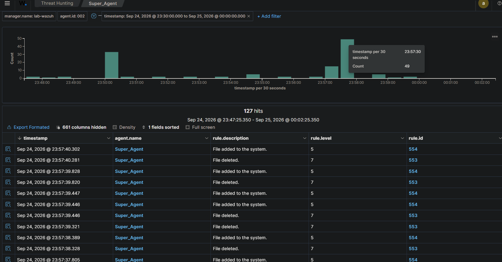
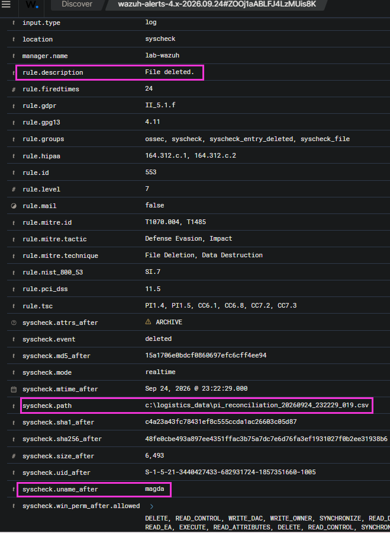

# Ransomware File Integrity Monitoring (FIM) Lab

> **Last reviewed:** 2026-11-12 | **Status:** Draft

## Standards mapping

| Framework | Reference |
|---|---|
| OWASP Top 10:2025 | Not strictly applicable (Endpoint/Infrastructure focus rather than Web App) |
| MITRE ATT&CK (v19) | TA0040 Impact / T1486 Data Encrypted for Impact<br>TA0009 Collection / T1005 Data from Local System |
| CWE | N/A - Ransomware is a malware payload, not a software vulnerability |
| CAPEC | CAPEC-608: Ransomware |
| Example CVEs | CVE-2017-0144 (EternalBlue, often leveraged for lateral movement) |

## What it is
Ransomware is a destructive malware payload that encrypts business-critical files and demands a ransom for the decryption key. In a corporate environment, attackers target operational data (such as Perpetual Inventory and Good Faith Receiving records) because disrupting these assets immediately halts business operations, maximizing extortion leverage.

## How it works
The ransomware execution flow typically involves traversing local and mapped network directories, identifying high-value files (like `.csv`, `.xlsx`, `.pdf`), and using strong cryptographic algorithms (e.g., AES/RSA) to encrypt the content. The original files are then deleted or overwritten, their extensions are changed (e.g., `.locked`), and a ransom note is dropped in the affected directories.

## Real-world example
**Expeditors International (February 2022)**
- **What happened:** The global logistics and freight forwarding company was hit by a massive ransomware attack that forced them to shut down most of their core operating systems globally.
- **Impact:** Operations at ports and warehouses were severely disrupted, forcing employees to revert to manual, paper-based processes for inventory and customs clearance. The financial impact was estimated in the tens of millions of dollars.
- **Source:** [Arctic Wolf: Top Cyberattacks of February 2022](https://arcticwolf.com/resources/blog/top-cyberattacks-february-2022/)

## Detection
- **Signals in logs and telemetry:**
  - Massive spike in file modifications, creations, and deletions within milliseconds.
  - Creation of files with anomalous extensions (`.locked`, `.encrypted`, `.wncry`).
  - Known ransom note filenames (e.g., `README_FOR_DECRYPT.txt`).
- **Tools and rules:**
  - **Wazuh (Syscheck):** Rule ID 550 (Integrity checksum changed), Rule ID 553 (File deleted), Rule ID 554 (File added).
  - **Sysmon:** Event ID 11 (FileCreate) showing rapid creation of `.locked` files by an untrusted parent process (Event ID 1).
- **Scripts in this repository:** 
  - `ransomware_emulator.py` (Local emulation script)

## Prevention
1. **Offline and Immutable Backups (3-2-1 Rule):** Fixes the root cause of the impact by ensuring data can be restored without paying the ransom.
2. **Endpoint Detection and Response (EDR):** Blocks the execution of the encrypting process based on behavioral heuristics before mass encryption occurs.
3. **Network Segmentation:** Reduces risk by preventing the ransomware from moving laterally to inventory databases or other warehouse endpoints.
4. **Application Whitelisting / AppLocker:** Reduces risk by preventing unauthorized executables from running in user space.

## Code examples
This Python snippet demonstrates the core logic of the ransomware emulation (Impact phase).
*Requires Python 3.10+. Standard library only.*

```python
import os
import time

"""
DISCLAIMER: This script is for educational, defensive, and authorized testing purposes only. 
It is designed to simulate ransomware behavior in a controlled lab environment for File Integrity Monitoring (FIM). 
Do not use this code on production systems or without explicit permission.
"""

def emulate_encryption(target_directory: str, extension: str = ".locked") -> None:
    """Iterates through the target directory, modifies file content, and appends a new extension."""
    for root, _, files in os.walk(target_directory):
        for file in files:
            if not file.endswith(extension) and file != "RANSOM_NOTE.txt":
                filepath = os.path.join(root, file)
                try:
                    # Simulate encryption by overwriting content
                    with open(filepath, 'w') as f:
                        f.write("ENCRYPTED_DATA_SIMULATION_" + str(time.time()))
                    
                    # Rename file to simulate ransomware extension change
                    new_filepath = filepath + extension
                    os.rename(filepath, new_filepath)
                    print(f"[!] Encrypted: {new_filepath}")
                except PermissionError:
                    print(f"[-] Permission denied: {filepath}")

    # Drop ransom note
    note_path = os.path.join(target_directory, "RANSOM_NOTE.txt")
    with open(note_path, 'w') as note:
        note.write("YOUR FILES HAVE BEEN ENCRYPTED. THIS IS A FIM SIMULATION.")
```
## Common mistakes
- **Relying solely on FIM for protection:** FIM is a detection control, not a prevention control. By the time FIM alerts you, files are already being modified. FIM must be paired with automated response (EDR/XDR) to kill the offending process.
- **Keeping backups connected to the domain:** Attackers often seek out and encrypt connected backup shares (e.g., Veeam servers on the same Active Directory domain) before detonating the main payload.

## Test it safely & Lab Walkthrough
To test this safely:
1. Provision an isolated Virtual Machine (e.g., Ubuntu or Windows Sandbox).
2. Install the Wazuh Agent and configure `ossec.conf` to monitor a specific dummy folder (e.g., `C:\Logistics_Data\`).
3. Execute `data_generator.py` to populate the folder with fake `.csv` PI and GFR records.
4. Execute `ransomware_emulator.py` targeting **only** that specific dummy directory.
5. ⚠️ **Never point the script at `C:\` or your host machine's directories.**

### Blue Team Triage (Wazuh SIEM)
Once the offensive emulator is executed, the Wazuh Syscheck module immediately detects the mass alteration. 

**1. Alert Storm (Macro Analysis)**
An anomalous spike of FIM events concentrated within milliseconds is the primary behavioral indicator of ransomware.



- **Rule ID 550 (Integrity checksum changed):** Triggers when the payload overwrites the original content, irreversibly modifying the MD5/SHA1 hashes.
- **Rule ID 553 (File deleted):** Registered as the original operational `.csv` files disappear.
- **Rule ID 554 (File added):** Triggers simultaneously due to the appearance of new files featuring the malicious `.locked` extension.

**2. Log Triage & IoC Extraction (Micro Analysis)**
Expanding the critical logs reveals the exact compromised `syscheck.path`.



Amidst the volume of modifications, Rule 554 captures a classic Indicator of Compromise (IoC):
- **File Path:** `C:\Logistics_Data\URGENT_RESTORE_DATA.txt`

## References
- [MITRE ATT&CK: Data Encrypted for Impact (T1486)](https://attack.mitre.org/techniques/T1486/)
- [Wazuh Documentation: File Integrity Monitoring](https://documentation.wazuh.com/current/user-manual/capabilities/file-integrity/index.html)
- [CISA Ransomware Guide](https://www.cisa.gov/stopransomware)