# Cybersecurity Threats & Vulnerabilities Guide

[](LICENSE)
[](https://www.python.org/downloads/)
[](CONTRIBUTING.md)

An educational guide to understanding, detecting, and preventing common cybersecurity threats. Each topic pairs documentation with Python detection scripts and prevention examples.

## Table of Contents

- [About](#about)
- [Project status](#project-status)
- [Repository structure](#repository-structure)
- [Categories](#categories)
- [Getting started](#getting-started)
- [Usage](#usage)
- [Web app and API](#web-app-and-api)
- [Roadmap](#roadmap)
- [Contributing](#contributing)
- [License](#license)
- [Disclaimer](#disclaimer)

## About

This repository is for security professionals, developers, and students who want working examples next to the theory. A typical topic contains:

- **Documentation** on how the threat works
- **Detection scripts** that look for signs of the attack
- **Prevention examples** with code
- **Best practices** for implementation

The scripts are teaching material. Read and test them in a lab before relying on them in production.

## Project status

This is an early-stage guide. Six categories exist, and most topics have documentation plus detection and prevention scripts. Several topics named in earlier versions of this README are not written yet; they are listed under [Roadmap](#roadmap) instead of being counted as done.

## Repository structure

```mermaid
flowchart TD
    ROOT["cybersecurity-threats-guide/"]

    ROOT --> DOCS["Documentation"]
    ROOT --> NET["01 - Network Security"]
    ROOT --> WEB["02 - Web Application Security"]
    ROOT --> MAL["03 - Malware Analysis"]
    ROOT --> SOC["04 - Social Engineering"]
    ROOT --> CRYPTO["05 - Cryptography"]
    ROOT --> IR["06 - Incident Response"]
    ROOT --> API["Flask API (Experimental)"]
    ROOT --> APP["Next.js Site"]
    ROOT --> TOOLS["Tools"]

    DOCS --> README["README.md"]
    DOCS --> LICENSE["LICENSE"]
    DOCS --> CONTRIB["CONTRIBUTING.md"]
    DOCS --> TEMPLATE["TOPIC_TEMPLATE.md"]

    NET --> DDOS["DDoS Attacks"]
    NET --> MITM["Man-in-the-Middle"]
    NET --> PORT["Port Scanning"]

    DDOS --> DD["Detection"]
    DDOS --> DP["Prevention"]
    DD --> DD1["ddos_detection.py"]
    DD --> DD2["traffic_analyzer.py"]
    DP --> DP1["firewall_rules.txt"]
    DP --> DP2["rate_limiting.py"]

    MITM --> MD["Detection"]
    MITM --> MP["Prevention"]
    MD --> MD1["arp_spoof_detector.py"]
    MD --> MD2["ssl_strip_detector.py"]
    MP --> MP1["certificate_pinning.py"]
    MP --> MP2["ssl_tls_config.py"]

    PORT --> PD["Detection"]
    PORT --> PP["Prevention"]
    PD --> PD1["ids_rules.txt"]
    PD --> PD2["port_scan_detector.py"]
    PP --> PP1["firewall_config.py"]
    PP --> PP2["stealth_mode.py"]

    WEB --> SQL["SQL Injection"]
    WEB --> XSS["XSS Attacks"]
    SQL --> SD["Detection"]
    SQL --> SP["Prevention"]
    SD --> SD1["sql_injection_detector.py"]
    SD --> SD2["sql_injection_scanner.py"]
    SP --> SP1["input_validation.py"]
    SP --> SP2["parameterized_queries.py"]
    XSS --> XD["Detection"]
    XD --> XD1["xss_detector.py"]

    MAL --> RANSOM["Ransomware"]
    MAL --> ROOTKIT["Rootkits"]
    MAL --> TROJAN["Trojans"]

    RANSOM --> RD["Detection"]
    RANSOM --> RP["Prevention"]
    RD --> RD1["file_monitor.py"]
    RD --> RD2["ransomware_behavior.py"]
    RP --> RP1["app_whitelisting.py"]
    RP --> RP2["backup_system.py"]

    ROOTKIT --> RKD["Detection"]
    ROOTKIT --> RKP["Prevention"]
    RKD --> RKD1["integrity_checker.py"]
    RKD --> RKD2["rootkit_detector.py"]
    RKP --> RKP1["kernel_patching.py"]
    RKP --> RKP2["secure_boot.py"]

    TROJAN --> TD["Detection"]
    TROJAN --> TP["Prevention"]
    TD --> TD1["process_analyzer.py"]
    TD --> TD2["trojan_scanner.py"]
    TP --> TP1["av_config.py"]
    TP --> TP2["sandbox_setup.py"]

    SOC --> PHISH["Phishing"]
    SOC --> PRETEXT["Pretexting"]
    PHISH --> PHD["Detection"]
    PHISH --> PHP["Prevention"]
    PHD --> PHD1["email_analyzer.py"]
    PHD --> PHD2["phishing_detector.py"]
    PHP --> PHP1["email_filters.py"]
    PHP --> PHP2["training_materials.md"]
    PRETEXT --> PTD["Detection"]
    PRETEXT --> PTP["Prevention"]
    PTD --> PTD1["social_engineering_detector.py"]
    PTP --> PTP1["security_policy.md"]

    CRYPTO --> ENC["Encryption"]
    CRYPTO --> HASH["Hashing"]
    ENC --> SYM["Symmetric Encryption"]
    SYM --> AES["aes_example.py"]
    HASH --> HASH1["integrity_checker.py"]
    HASH --> HASH2["password_hashing.py"]

    IR --> CONT["Containment"]
    IR --> FORENSICS["Forensics"]
    CONT --> CONT1["backup_recovery.py"]
    CONT --> CONT2["isolation_script.py"]
    FORENSICS --> FOR1["disk_forensics.py"]
    FORENSICS --> FOR2["memory_analyzer.py"]

    API --> APINOTE["Experimental API"]
    APP --> APPNOTE["cybersec-app/README.md"]
    TOOLS --> T1["setup_tools.sh"]
    TOOLS --> T2["requirements.txt"]
    TOOLS --> T3["requirements-optional.txt"]

    classDef root fill:#17365D,color:#FFFFFF,stroke:#0B1F38,stroke-width:2px
    classDef domain fill:#D9EAF7,color:#17365D,stroke:#4682B4,stroke-width:1px
    classDef topic fill:#E2F0D9,color:#24511A,stroke:#70AD47
    classDef module fill:#FFF2CC,color:#7F6000,stroke:#D6B656
    classDef support fill:#E4DFEC,color:#403152,stroke:#8064A2

    class ROOT root
    class NET,WEB,MAL,SOC,CRYPTO,IR domain
    class DDOS,MITM,PORT,SQL,XSS,RANSOM,ROOTKIT,TROJAN,PHISH,PRETEXT,ENC,HASH,CONT,FORENSICS topic
    class DD,DP,MD,MP,PD,PP,SD,SP,XD,RD,RP,RKD,RKP,TD,TP,PHD,PHP,PTD,PTP,SYM module
    class DOCS,API,APP,TOOLS support

```



## Categories

Topics marked *planned* do not have content yet.

### 1. [Network Security](01-network-security/README.md)

- [DDoS Attacks](01-network-security/ddos-attacks/README.md)
- [Man-in-the-Middle](01-network-security/man-in-the-middle/README.md)
- [Port Scanning](01-network-security/port-scanning/README.md)
- [DNS Spoofing](01-network-security/dns-spoofing/README.md)

### 2. [Web Application Security](02-web-application-security/README.md)

- [SQL Injection](02-web-application-security/sql-injection/README.md)
- [Cross-Site Scripting (XSS)](02-web-application-security/xss-attacks/README.md)
- [Cross-Site Request Forgery (CSRF)](02-web-application-security/csrf/README.md)
- [Session Hijacking](02-web-application-security/session-hijacking/README.md)
- [File Inclusion and Path Traversal](02-web-application-security/file-inclusion/README.md)
- [Security Misconfiguration](02-web-application-security/security-misconfig/README.md)

### 3. [Malware Analysis](03-malware-analysis/README.md)

- [Ransomware](03-malware-analysis/ransomware/README.md)
- [Trojans](03-malware-analysis/trojans/README.md)
- [Rootkits](03-malware-analysis/rootkits/README.md)
- [Keyloggers](03-malware-analysis/keyloggers/README.md) (detection only)

### 4. [Social Engineering](04-social-engineering/README.md)

- [Phishing](04-social-engineering/phishing/README.md)
- [Pretexting](04-social-engineering/pretexting/README.md)
- [Baiting](04-social-engineering/baiting/README.md)
- [Tailgating](04-social-engineering/tailgating/README.md)

### 5. [Cryptography](05-cryptography/README.md)

- Symmetric encryption (hybrid AES example)
- [Asymmetric encryption (RSA)](05-cryptography/encryption/asymmetric/README.md)
- [Hashing and password hashing](05-cryptography/hashing/README.md)
- [Digital signatures](05-cryptography/digital-signatures/README.md)
- [Key management](05-cryptography/key-management/README.md)

### 6. [Incident Response](06-incident-response/README.md)

- [Digital forensics](06-incident-response/forensics/README.md)
- Containment and recovery scripts
- [Post-incident analysis](06-incident-response/post-incident/README.md)

## Getting started

### Prerequisites

- Python 3.10 or higher
- pip
- Basic understanding of networking and security concepts
- Administrative privileges for scripts that capture packets or inspect processes

### Installation

1. Clone the repository:

```bash
git clone https://github.com/s4ntrx/Cybersecurity-Threats-Guide.git
cd Cybersecurity-Threats-Guide
```

2. Create a virtual environment and install dependencies:

```bash
python3 -m venv .venv
source .venv/bin/activate
pip install -r tools/requirements.txt
```

Some scripts also need system software: `tshark` (Wireshark) for `traffic_analyzer.py` and a running Redis server for `rate_limiting.py`. Registry checks in the ransomware detector only run on Windows.

3. Optional: memory forensics support (installs Volatility 3):

```bash
pip install -r tools/requirements-optional.txt
```

`tools/setup_tools.sh` checks your Python version and system tools if you prefer a guided setup.

## Usage

### Running detection scripts

```bash
cd 01-network-security/ddos-attacks/detection/
sudo python ddos_detection.py --interface eth0 --threshold 1000
```

Run `python <script>.py --help` to see the options for any script.

### Using prevention examples

```bash
cd 02-web-application-security/sql-injection/prevention/
python parameterized_queries.py
```

Or import the class directly:

```python
from parameterized_queries import SecureDatabaseQueries

db = SecureDatabaseQueries(db_type="sqlite", db_name="demo.db")
db.connect()
db.create_users_table()
user = db.get_user_secure("alice")
```

## Web app and API

- `cybersec-app/` is a Next.js site that presents the guide's content. Setup is in [cybersec-app/README.md](cybersec-app/README.md).
- `api/` is a small Flask API with health, tools, and scan endpoints. It is experimental: its HTML routes expect `templates/` and `static/` directories that are not in the repository yet.

## Roadmap

Remaining gaps:

- New topics were added in October 2026 and are marked Draft: their references still need an independent review, and several "Real-world example" sections need a primary source added
- Apply the [topic template](TOPIC_TEMPLATE.md) (standards mapping and review date) to the older topics: ransomware, trojans, rootkits, phishing, pretexting, DDoS, MITM, port scanning, forensics
- SQL injection WAF rules; a README for the containment scripts and for symmetric encryption
- Topics listed as planned in the category pages: ARP poisoning page, worms, botnets, quid pro quo, vishing, smishing
- A `resources/` folder of links, books, and certifications
- Test the scripts that change system state (firewall, isolation, sandbox, kernel hardening, secure boot, antivirus configuration) in a disposable virtual machine; they have only been reviewed by reading the code

## Contributing

Contributions are welcome. Read the [Contributing Guidelines](CONTRIBUTING.md) first, and start new topics from [TOPIC_TEMPLATE.md](TOPIC_TEMPLATE.md). Then:

1. Fork the repository
2. Create a feature branch (`git checkout -b feature/your-feature`)
3. Commit your changes
4. Push the branch
5. Open a Pull Request

## License

MIT. See [LICENSE](LICENSE).

## Disclaimer

**IMPORTANT**: The code and information in this repository are for **educational and defensive purposes only**.

- Do not use these techniques against systems you do not own or have explicit permission to test
- Follow responsible disclosure practices
- The author is not responsible for misuse of this material
- Some scripts may trigger security alerts, so use them only in controlled environments
